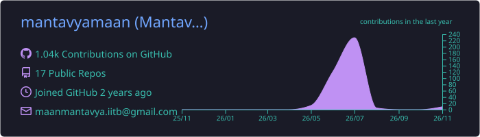
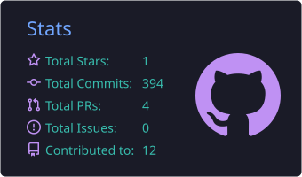
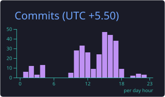
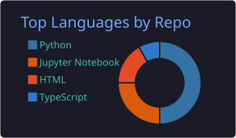
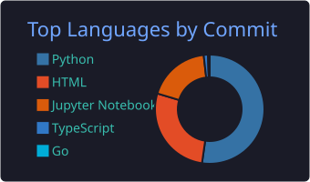

<!-- ===================== HEADER ===================== -->
<p align="center">
  
</p>

<p align="center">
  <a href="https://github.com/mantavyamaan">
    
  </a>
</p>

<p align="center">
  <a href="https://www.linkedin.com/in/mantavya-maan-892304277"></a>
  <a href="https://mantavyamaan.github.io/"></a>
  <a href="mailto:maanmantavya.iitb@gmail.com"></a>
  <a href="https://github.com/mantavyamaan"></a>
</p>

---

<!-- ===================== ABOUT ===================== -->


### 🧠 About me

```python
class Mantavya:
    education  = "B.S. Mathematics, IIT Bombay  (2023 – 2027)"
    minor      = "Game Theory & Logic, CSE"
    builds     = ["LLM routing", "LLM evaluation", "agent orchestration", "RAG"]
    toolkit    = ["Bayesian inference", "Thompson sampling", "sequential testing",
                  "multi-objective optimization"]
    experience = ["Palpx", "Gradpipe", "Fino Payments Bank"]
    status     = "Open to remote AI/ML & AI-infra internships"

    def philosophy(self):
        return "Ship systems that know when they're uncertain."
```

<br clear="right"/>

---

<!-- ===================== PROJECTS ===================== -->
### 🚀 Featured work

<table>
<tr>
<td width="50%" valign="top">

#### ⚡ [Neural Gateway](https://github.com/mantavyamaan/Neural-Gateway)
LLM routing control plane — scores models on quality, cost, latency and reliability, reduces to a **Pareto frontier**, and uses **Thompson sampling** to decide, abstaining when no model clearly wins.

`65% lower latency` `6,000+ labeled prompts` `live OpenRouter sync`

<a href="https://mantavyamaan.github.io/Neural-Gateway/demo"></a>


</td>
<td width="50%" valign="top">

#### 🧪 [Prompt Optimizer](https://github.com/mantavyamaan/Prompt_optimizer)
Local-first LLMOps loop that evolves prompts and promotes them **only on evidence** — anytime-valid confidence sequences and a champion–challenger gate.

`sequential testing` `shadow A/B on 10% traffic` `p95 latency fences`

<a href="https://mantavyamaan.github.io/Prompt_optimizer/docs/"></a>


</td>
</tr>
<tr>
<td width="50%" valign="top">

#### 🕸️ [Multi-Agent Orchestrator](https://github.com/mantavyamaan/Multi-Agent-Orchestrator)
Agent runtime on **LangGraph** — a planner builds a dependency DAG and a scheduler fans ready tasks out to parallel workers.

`Map-Reduce DAG` `dynamic tool binding` `persistent memory`

<a href="https://mantavyamaan.github.io/Multi-Agent-Orchestrator/demo"></a>


</td>
<td width="50%" valign="top">

#### 📚 [DocuMind AI](https://github.com/mantavyamaan/DocuMind-AI) &nbsp;·&nbsp; 📈 [Lead Score](https://github.com/mantavyamaan/Lead_Score)
**DocuMind** — fully offline RAG over your own documents, with citations and grounding evaluation.

**Lead Score** — explainable lead-qualification model: 10 parameters, Bayesian priors, Beta confidence intervals, hard gates.

<a href="https://mantavyamaan.github.io/Lead_Score/lead-score-console.html"></a>


</td>
</tr>
</table>

<sub>💡 [Atlas Router](https://github.com/mantavyamaan/Atlas-Router) is the browser-portable prototype that became Neural Gateway.</sub>

---

<!-- ===================== STACK ===================== -->
### 🛠️ Tech stack

<p align="center">
  
</p>

<p align="center">
  
  
  
  
  
  
  
  
</p>

---

<!-- ===================== STATS ===================== -->
### 📊 GitHub activity

<p align="center">
  
</p>

<p align="center">
  
  
</p>

<p align="center">
  
  
</p>

<p align="center">
  
</p>

<p align="center">
  <picture>
    <source media="(prefers-color-scheme: dark)" srcset="https://raw.githubusercontent.com/mantavyamaan/mantavyamaan/output/github-snake-dark.svg" />
    <source media="(prefers-color-scheme: light)" srcset="https://raw.githubusercontent.com/mantavyamaan/mantavyamaan/output/github-snake.svg" />
    
  </picture>
</p>

<!-- ===================== FOOTER ===================== -->
<p align="center">
  
</p>
